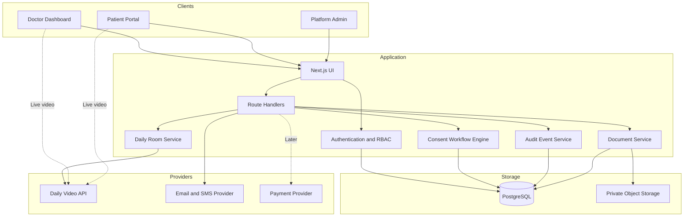
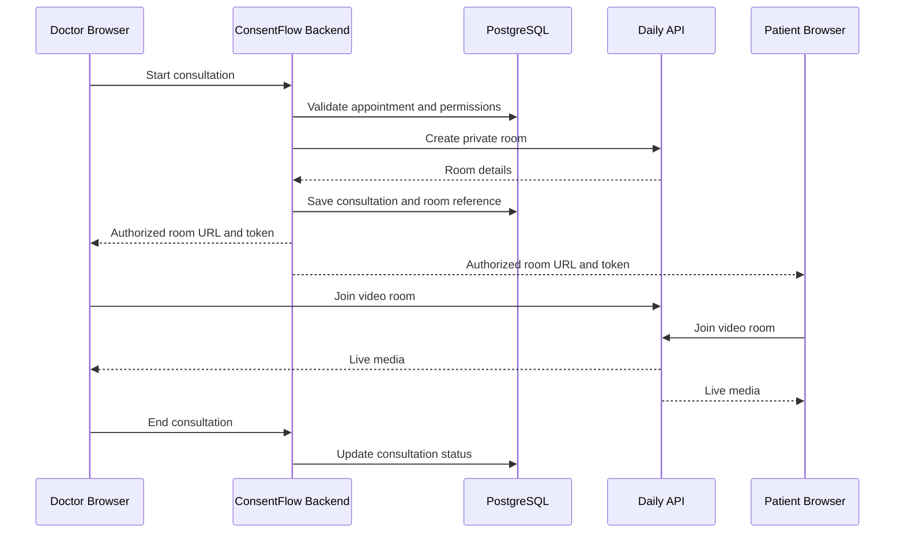
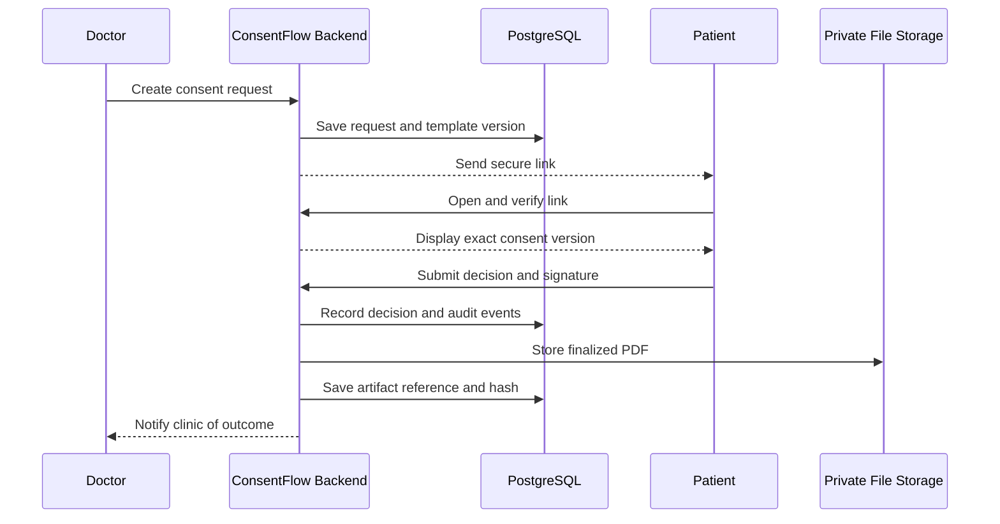

# ConsentQueue — Digital Consent SaaS

**Document type:** Product & Technical Specification  
**Version:** 1.0  
**Status:** MVP Planning  
**Initial market:** India  
**Primary customers:** Independent doctors and small clinics  
**Video provider:** Daily  
**Proposed stack:** Next.js, TypeScript, PostgreSQL, Prisma

---

## 1. Product Overview

### 1.1 Description

ConsentFlow is a clinic-focused SaaS platform that enables healthcare providers to create, send, collect, verify, and manage digital patient consent records.

The platform also provides embedded live video consultations using Daily's video API.

The goal is to replace fragmented paper-based consent workflows with a secure, traceable, and accessible digital process.

### 1.2 Problem Statement

Clinics may face challenges such as:

- Paper forms being lost or difficult to retrieve.
- Missing signatures or incomplete forms.
- Manual follow-ups with patients.
- Difficulty tracking pending consent requests.
- Unclear document version history.
- Poor organization of consent records.
- Limited visibility into who performed an action and when.

ConsentFlow aims to make these workflows easier to manage.

### 1.3 Target Customers

Initial focus:

- Independent medical practitioners.
- Small clinics.
- Dental clinics.
- Dermatology and aesthetic clinics.
- Clinics offering remote consultations.

Start with one specialty during the pilot. Different specialties have different consent requirements and workflows.

### 1.4 Value Proposition

ConsentFlow provides:

- Digital consent forms.
- Reusable and versioned templates.
- Secure patient access links.
- Electronic signature workflows.
- Consent status tracking.
- Downloadable consent records.
- Audit history.
- Embedded video consultations.
- Clinic-level user permissions.

### 1.5 Business Model

Use a clinic subscription model.

Indicative prices to validate with prospective customers:

| Plan | Monthly price | Target |
|---|---:|---|
| Starter | ₹499 | Solo practitioner |
| Professional | ₹1,499 | Individual doctor with regular usage |
| Clinic | ₹2,999 | Small clinic with multiple staff |

These are initial pricing experiments, not validated market rates.

Potential future revenue sources include:

- Higher usage limits.
- Additional clinic staff accounts.
- Advanced reporting.
- Custom consent templates.
- Integrations with clinic-management software.

Do not introduce complex billing until clinics demonstrate regular usage and willingness to pay.

---

## 2. MVP Scope

### 2.1 Must-Have Features

#### Clinic Dashboard

- Doctor and staff login.
- Clinic profile.
- Role-based permissions.
- Appointment management.
- Consent request management.
- Pending and completed consent views.
- Patient record search.
- PDF export.

#### Consent Management

- Create reusable consent templates.
- Create versioned document content.
- Send consent requests.
- Generate secure patient links.
- Capture agreement or refusal.
- Capture an appropriate electronic signature.
- Record relevant timestamps and verification events.
- Preserve the exact document presented.
- Track completed, declined, expired, and withdrawn requests where applicable.

#### Video Consultation

- Create private Daily rooms.
- Issue authorized participant tokens.
- Embed video calling in the website.
- Allow microphone and camera controls.
- End a consultation.
- Track consultation status.
- Prevent unauthorized room access.

#### Patient Portal

- Open a secure consent link.
- Verify identity when required.
- Review the consent document.
- Ask questions or contact the clinic.
- Agree or decline.
- Complete the signature process.
- Receive confirmation when appropriate.

### 2.2 Out of Scope for the Initial MVP

Avoid building these until the core workflow is validated:

- Full electronic health record system.
- AI diagnosis.
- Online pharmacy.
- Insurance claims.
- Complex hospital-management functionality.
- Custom video infrastructure.
- Automatic transcription or recording.
- Multi-country legal template libraries.
- Advanced analytics and enterprise integrations.

---

## 3. Technology Stack

| Layer | Technology | Purpose |
|---|---|---|
| Frontend | Next.js | Web application |
| Language | TypeScript | Type safety |
| UI | Tailwind CSS | Styling |
| Components | shadcn/ui | Reusable interface components |
| Backend | Next.js Route Handlers | API endpoints and business logic |
| Database | PostgreSQL | Structured application data |
| ORM | Prisma | Queries and migrations |
| Authentication | Auth.js or a suitable managed provider | User authentication |
| Video | Daily Prebuilt and Daily REST API | Embedded video consultations |
| File storage | Private S3-compatible object storage | Consent PDFs and documents |
| Email | Transactional email provider | Invitations and notifications |
| SMS | Suitable India-based SMS provider | OTP and notifications |
| Payments | Razorpay, later | Subscription billing |
| Hosting | Next.js-compatible hosting | Application deployment |
| Monitoring | Error monitoring and structured logs | Reliability and troubleshooting |

### 3.1 Architectural Recommendation

Use a modular monolith for the MVP.

Keep the application in one deployable Next.js codebase, but separate business logic into modules.

Suggested modules:

- Authentication.
- Clinics and memberships.
- Patients.
- Appointments.
- Consultations.
- Consent templates.
- Consent requests.
- Documents.
- Audit events.
- Notifications.
- Billing.

This is easier to develop and maintain than starting with multiple microservices.

### 3.2 Daily API Key Security

The Daily API key must remain on the server.

Never expose the secret key through:

- Client-side environment variables.
- Browser JavaScript.
- Public API responses.
- Git repositories.
- Frontend configuration files.

The backend creates rooms and generates participant-specific meeting tokens.

---

## 4. System Architecture

### 4.1 High-Level Diagram



### 4.2 Component Responsibilities

**Next.js application**

Serves the dashboard, patient portal, consent pages, and API endpoints.

**Authentication and authorization**

Verifies the user and checks permissions before accessing clinic or patient information.

**Consent workflow engine**

Manages document versions, consent requests, patient decisions, expiration, and withdrawal events.

**Daily room service**

Creates video rooms, issues meeting tokens, validates appointment access, and handles room lifecycle events.

**Document service**

Generates PDFs and manages private document storage.

**Audit service**

Records important actions, including document issuance, signing, refusals, and administrative changes.

**PostgreSQL**

Stores structured application data and relationships.

**Private object storage**

Stores finalized PDFs and permitted uploaded files.

**Notification service**

Sends appointment invitations and consent links without including unnecessary sensitive medical information.

---

## 5. User Roles

### 5.1 Platform Administrator

Responsibilities:

- Manage platform-level configuration.
- Manage clinic accounts.
- Review system health.
- Investigate support issues with authorized access.
- Manage subscription plans.

Administrative access must not provide unrestricted, invisible access to medical information.

### 5.2 Clinic Owner

Responsibilities:

- Manage clinic profile.
- Invite staff.
- Assign permissions.
- Manage templates.
- View authorized clinic records.
- Manage subscriptions.

### 5.3 Doctor

Responsibilities:

- Manage appointments.
- Conduct consultations.
- Create consent requests.
- Review consent status.
- Access authorized patient records.
- Download authorized consent documents.

### 5.4 Clinic Staff

Responsibilities depend on assigned permissions.

Possible permissions:

- Schedule appointments.
- Send consent requests.
- Check request status.
- Manage nonclinical administrative details.

Staff should not automatically receive permission to access all medical or consent records.

### 5.5 Patient

Responsibilities:

- Access an authorized patient link.
- Review the presented document.
- Ask questions where appropriate.
- Agree or decline.
- Complete the required signature workflow.
- Access confirmation or a copy where appropriate.

---

## 6. Workflow A — Live Video Consultation

### Step 1: Appointment Creation

The doctor or authorized staff creates an appointment.

Required information may include:

- Doctor.
- Patient.
- Scheduled time.
- Appointment status.
- Clinic.

### Step 2: Doctor Starts Consultation

The doctor selects the appointment and clicks "Start Consultation."

The backend verifies:

- The doctor is authenticated.
- The doctor belongs to the clinic.
- The doctor is authorized for the appointment.
- The appointment is eligible for a consultation.
- The request complies with room-creation rules.

### Step 3: Create Daily Room

The backend creates a private Daily room using the Daily REST API.

Room settings should include appropriate:

- Privacy.
- Expiration.
- Access restrictions.
- Recording restrictions.
- Participant permissions.

Room creation must be idempotent where practical, so retries do not create unnecessary duplicate rooms.

### Step 4: Issue Participant Tokens

The backend generates separate meeting tokens for the authorized participants.

Tokens should:

- Be limited to the relevant room.
- Expire appropriately.
- Grant only required permissions.
- Be issued only after authorization checks.
- Never be exposed in logs or analytics.

### Step 5: Join the Call

The doctor and patient join the embedded Daily interface.

The browser requests camera and microphone permissions.

The application handles:

- Permission denial.
- Device selection.
- Network failures.
- Participant disconnection.
- Rejoining where permitted.
- Call termination.

### Step 6: End Consultation

When the consultation ends:

- Update consultation status.
- Record relevant timestamps.
- Revoke or expire access as appropriate.
- Process authenticated provider webhooks where configured.
- Preserve relevant operational audit events.

Do not assume a browser closing means a consultation ended successfully. Network interruptions and disconnections must be handled.

### Video Architecture



The patient link should not expose a permanent room credential. Use an authenticated or securely verified flow to obtain the meeting token.

---

## 7. Workflow B — Digital Consent

### Step 1: Create Template

The doctor selects an approved template.

Possible fields include:

- Consent title.
- Procedure or treatment description.
- Expected benefits.
- Material risks.
- Alternatives.
- Opportunity to ask questions.
- Patient acknowledgement.
- Applicable signature fields.
- Required witness or representative fields, when applicable.

Template content must be reviewed by qualified healthcare professionals and legal counsel.

### Step 2: Create a Versioned Document

When a consent request is issued, preserve the exact version of the template presented to the patient.

Subsequent template edits must not silently modify an already issued consent request.

### Step 3: Create Consent Request

The backend creates a consent request with:

- Patient reference.
- Clinic reference.
- Doctor reference.
- Template version.
- Issue time.
- Expiration.
- Current status.

### Step 4: Send Secure Link

The patient receives a secure link through email or SMS.

The link should be:

- Unpredictable.
- Time-limited.
- Revocable.
- Protected against reuse where appropriate.
- Free of sensitive medical information in the URL.

Store a hash of a random link token rather than the raw token where practical.

### Step 5: Patient Verification

Use an identity-verification process appropriate to the risk and legal requirements.

Possible mechanisms include:

- Verified contact channel.
- One-time password.
- Authenticated patient account.
- Additional identity verification for higher-risk workflows.

A verified phone number alone does not prove legal identity in every circumstance.

### Step 6: Review and Decision

The patient reviews the document and explicitly chooses an available action.

Possible outcomes:

- Agreed.
- Declined.
- Expired.
- Withdrawn, where applicable.

The interface must not preselect agreement or use misleading controls.

Patients must have an appropriate opportunity to ask questions and receive necessary explanations.

### Step 7: Capture Signature and Evidence

Record appropriate evidence, such as:

- Exact document version.
- Patient or representative reference.
- Signature method.
- Relevant verification events.
- Timestamp.
- Consent decision.
- Audit event identifiers.

The exact requirements depend on the document, clinical context, and applicable law.

### Step 8: Finalize Record

After successful completion:

- Generate a finalized PDF.
- Calculate a cryptographic hash of the final document.
- Store the document in private object storage.
- Save the document reference and hash.
- Record the finalization event.
- Make the record available to authorized users.
- Provide a patient copy where appropriate.

A document hash can help detect changes, but it does not by itself prove identity, informed consent, or legal validity.

### Consent Sequence



---

## 8. Database Schema

Use PostgreSQL with Prisma.

The following is the initial logical data model, not a complete production schema.

### 8.1 Users

`users`

- `id`
- `name`
- `email`
- `auth_provider_id`
- `created_at`
- `updated_at`

Authentication credentials should be managed by the selected authentication system.

### 8.2 Clinics

`clinics`

- `id`
- `name`
- `settings`
- `created_at`
- `updated_at`

### 8.3 Clinic Memberships

`clinic_members`

- `id`
- `clinic_id`
- `user_id`
- `role`
- `status`
- `created_at`

Add a unique constraint on the clinic/user pair.

### 8.4 Patients

`patients`

- `id`
- `clinic_id`, where the chosen tenancy model requires it
- `name`
- `contact_details`, limited to necessary fields
- `created_at`
- `updated_at`

Avoid collecting unnecessary medical or identity information.

### 8.5 Appointments

`appointments`

- `id`
- `clinic_id`
- `doctor_id`
- `patient_id`
- `scheduled_at`
- `status`
- `created_at`
- `updated_at`

### 8.6 Consultations

`consultations`

- `id`
- `appointment_id`
- `provider`
- `provider_room_id`
- `started_at`
- `ended_at`
- `status`
- `created_at`

Do not store Daily API secrets or reusable room credentials in this table.

### 8.7 Consent Templates

`consent_templates`

- `id`
- `clinic_id`
- `title`
- `status`
- `created_at`
- `updated_at`

### 8.8 Template Versions

`consent_template_versions`

- `id`
- `template_id`
- `version`
- `content_snapshot`
- `content_hash`
- `created_at`
- `created_by`

Use immutable versions once they have been issued in consent requests.

### 8.9 Consent Requests

`consent_requests`

- `id`
- `clinic_id`
- `patient_id`
- `appointment_id`, nullable
- `template_version_id`
- `status`
- `issued_at`
- `expires_at`
- `completed_at`
- `created_by`

Possible status values:

- `draft`
- `pending`
- `agreed`
- `declined`
- `expired`
- `withdrawn`

Enforce valid transitions through backend logic.

### 8.10 Consent Events

`consent_events`

- `id`
- `consent_request_id`
- `event_type`
- `actor_id`, nullable where appropriate
- `occurred_at`
- `metadata`

Events may include:

- Request issued.
- Link accessed.
- Identity verification completed.
- Document viewed.
- Questions or clarification recorded.
- Agreement submitted.
- Decline submitted.
- Withdrawal recorded.
- Document finalized.

Do not store unnecessary sensitive information in event metadata.

### 8.11 Consent Artifacts

`consent_artifacts`

- `id`
- `consent_request_id`
- `storage_key`
- `document_hash`
- `mime_type`
- `created_at`
- `created_by`

### 8.12 Audit Logs

`audit_logs`

- `id`
- `clinic_id`
- `actor_id`
- `action`
- `resource_type`
- `resource_id`
- `occurred_at`
- `correlation_id`
- `metadata`

Do not log passwords, access tokens, signature secrets, or unnecessary medical details.

### Database Rules

- Use random, non-guessable identifiers.
- Use foreign keys and database constraints.
- Enforce clinic-level isolation on every relevant operation.
- Consider PostgreSQL row-level security as defense in depth.
- Use transactions for critical consent transitions.
- Avoid hard-deleting finalized records when retention rules require preservation.
- Implement authorized correction and withdrawal workflows.
- Define backup, restoration, and retention procedures.

---

## 9. Security and Privacy

Healthcare information requires stronger protection than ordinary application data.

### Authentication

- Use secure session management.
- Require strong authentication for doctors and administrators.
- Consider multi-factor authentication for privileged roles.
- Implement session expiration and revocation.
- Rate-limit login and verification endpoints.

### Authorization

- Enforce role-based permissions on the server.
- Verify clinic membership on every protected request.
- Verify patient access to individual consent requests.
- Never rely only on hidden frontend controls.
- Test for insecure direct object references.

### Data Protection

- Use HTTPS.
- Encrypt sensitive data at rest.
- Restrict database and storage access.
- Keep secrets in a managed secret store.
- Use private buckets and short-lived download URLs.
- Minimize collected data.
- Establish retention and deletion policies.
- Maintain tested backups.

### Consent Integrity

- Preserve issued document versions.
- Record important events in an append-only or tamper-evident audit system.
- Hash finalized documents.
- Restrict changes to completed records.
- Record corrections and withdrawals as separate events.
- Make audit access permission-controlled.

An append-only application table is not automatically tamper-proof against a privileged database administrator. Stronger integrity guarantees may require separate protected logging and independent backups.

### Video Security

- Use private Daily rooms.
- Issue participant-specific meeting tokens.
- Use short-lived credentials.
- Restrict room access to authorized participants.
- Configure room expiry.
- Avoid recording by default.
- Verify webhook signatures where supported.
- Prevent credentials from appearing in logs or analytics.
- Review provider data-processing terms and regional data-handling options.

### Privacy by Default

- Do not place medical details in URLs.
- Do not expose patient names in public meeting room names.
- Do not use patient data for analytics without an appropriate legal basis.
- Avoid unnecessary third-party trackers on patient pages.
- Do not enable transcription or recording by default.

---

## 10. India Compliance Considerations

Before handling real patients, obtain qualified advice on applicable requirements.

Review:

- India's Telemedicine Practice Guidelines.
- Applicable Digital Personal Data Protection requirements and commencement rules.
- Applicable electronic-signature and electronic-record laws.
- Medical confidentiality and record-retention obligations.
- Rules applicable to the selected specialty and clinical procedure.
- Appropriate consent for video or audio recording, if ever introduced.
- Data-processing agreements with hosting, messaging, storage, and video providers.

Useful starting points:

- Telemedicine Practice Guidelines:  
  https://esanjeevani.mohfw.gov.in/assets/guidelines/Telemedicine_Practice_Guidelines.pdf

- India Code:  
  https://www.indiacode.nic.in/

Legal validity depends on the context and workflow. Do not advertise the platform as guaranteeing legally valid consent without appropriate review.

---

## 11. Daily Video API Pricing Assumptions

Daily's published standard pricing referenced during initial planning:

- First 10,000 participant-minutes per month included in the relevant free allowance.
- Standard usage rate thereafter: $0.004 per participant-minute in the next usage tier.
- Recording, premium features, healthcare-related add-ons, and other services may cost extra.

Verify current prices, eligibility, plan terms, and contractual conditions before launch:

https://www.daily.co/pricing/video-sdk/

### Example Calculation

Assumptions:

- Two participants per consultation.
- Average consultation duration: 20 minutes.
- Total participant-minutes = calls × 20 × 2.
- First 10,000 participant-minutes are included.
- Usage above that allowance costs $0.004 per participant-minute.

| Calls/month | Participant-minutes | Estimated video cost |
|---:|---:|---:|
| 100 | 4,000 | $0 |
| 250 | 10,000 | $0 |
| 500 | 20,000 | $40 |
| 1,000 | 40,000 | $120 |

These calculations exclude taxes, currency conversion, hosting, storage, SMS, email, and optional services.

Do not assume the free allowance is a hard spending cap. Implement application-level usage monitoring and budget alerts.

### Cost Controls

- Set maximum consultation durations where appropriate.
- Track participant-minutes.
- Alert administrators as usage increases.
- Avoid duplicate room creation.
- Clean up expired rooms.
- Disable unnecessary recording features.
- Monitor failed joins and abandoned rooms.

---

## 12. Development Milestones

### Milestone 1 — Foundation

Tasks:

- Create Next.js project.
- Configure TypeScript and UI components.
- Set up PostgreSQL.
- Configure Prisma and migrations.
- Implement authentication.
- Create clinic and membership models.
- Implement role-based authorization.
- Build the initial dashboard layout.

Acceptance criteria:

- Users can sign in and sign out.
- Clinic memberships are enforced.
- A user cannot access another clinic's data.
- Database migrations are repeatable.

### Milestone 2 — Consent Engine

Tasks:

- Create consent templates.
- Implement immutable template versions.
- Create consent requests.
- Build patient consent pages.
- Implement secure, expiring links.
- Capture agreement or decline.
- Record consent events.
- Implement the initial audit history.

Acceptance criteria:

- A patient can open an authorized request.
- The exact issued document version is preserved.
- Agreement and decline are separate outcomes.
- Unauthorized users cannot view the request.
- Important transitions are recorded.

### Milestone 3 — Daily Integration

Tasks:

- Create a Daily developer account.
- Configure server-side API credentials.
- Implement private room creation.
- Issue room-specific participant tokens.
- Build the embedded video interface.
- Handle camera and microphone permissions.
- Implement consultation status.
- Configure expiration and access restrictions.

Acceptance criteria:

- Authorized doctor and patient can join the intended room.
- Unauthorized users cannot obtain valid room access.
- API secrets never reach the browser.
- Disconnections and failed joins are handled.
- Room creation and expiration are tested.

### Milestone 4 — Documents and Production Hardening

Tasks:

- Generate finalized PDFs.
- Configure private file storage.
- Store document hashes.
- Implement controlled downloads.
- Add rate limiting.
- Add security logging.
- Configure backups.
- Test restoration.
- Add monitoring and alerting.
- Review data retention and deletion policies.

Acceptance criteria:

- Authorized users can retrieve completed records.
- Unauthorized users cannot access documents.
- Document integrity can be checked.
- Backup restoration has been tested.
- Sensitive data is excluded from unnecessary logs.

### Milestone 5 — Clinic Pilot

Tasks:

- Recruit three to five pilot clinics.
- Use reviewed consent templates.
- Train clinic staff.
- Observe real workflows.
- Track completion and failure rates.
- Measure administrative time saved.
- Collect usability feedback.
- Review support burden and video costs.
- Validate willingness to pay.

Acceptance criteria:

- Clinics can complete the core workflow without developer intervention.
- Critical security issues are resolved.
- Consent records can be retrieved reliably.
- There is evidence of repeated usage.
- At least some pilot customers demonstrate willingness to pay.

---

## 13. Success Metrics

Track product usage and operational quality.

### Activation

- Clinics completing setup.
- Time to first consent request.
- Percentage of invited patients who open their link.

### Workflow Quality

- Consent completion rate.
- Decline rate.
- Expired request rate.
- Median time to completion.
- Failed signature submissions.
- Support requests per clinic.

### Business

- Trial-to-paid conversion.
- Monthly recurring revenue.
- Clinic retention.
- Revenue per clinic.
- Customer acquisition cost.
- Gross margin after video and infrastructure costs.

### Reliability

- Video join success rate.
- Failed room creation.
- API error rate.
- PDF generation failures.
- Unauthorized access attempts.
- Backup restoration success.

Do not optimize for agreement rate alone. A clear, ethical consent process must allow patients to decline.

---

## 14. Recommended Repository Structure

```text
consentflow/
├── prisma/
│   ├── schema.prisma
│   └── migrations/
├── public/
├── src/
│   ├── app/
│   │   ├── (auth)/
│   │   ├── dashboard/
│   │   ├── patients/
│   │   ├── appointments/
│   │   ├── consultations/
│   │   ├── consent/
│   │   ├── patient-consent/
│   │   └── api/
│   │       ├── appointments/
│   │       ├── consultations/
│   │       ├── consent/
│   │       ├── daily/
│   │       └── webhooks/
│   ├── components/
│   │   ├── ui/
│   │   ├── dashboard/
│   │   ├── consent/
│   │   └── video/
│   ├── lib/
│   │   ├── auth/
│   │   ├── db/
│   │   ├── permissions/
│   │   ├── daily/
│   │   ├── storage/
│   │   ├── notifications/
│   │   └── validation/
│   └── server/
│       ├── consent/
│       ├── consultations/
│       ├── documents/
│       └── audit/
├── tests/
├── .env.example
├── package.json
└── README.md
```

Keep privileged operations in server-only modules. Validate inputs at API boundaries and test authorization rules independently from UI behavior.

---

## 15. Environment Variables

Example `.env.example`:

```dotenv
DATABASE_URL=

AUTH_SECRET=

DAILY_API_KEY=

STORAGE_ENDPOINT=
STORAGE_BUCKET=
STORAGE_ACCESS_KEY_ID=
STORAGE_SECRET_ACCESS_KEY=

EMAIL_API_KEY=

SMS_API_KEY=
```

Use the environment-variable names supported by your chosen libraries and hosting provider.

Never commit real credentials. Use a secret manager for production and rotate any credentials that may have been exposed.

---

## 16. Reference Documentation

### Application

- Next.js: https://nextjs.org/docs
- TypeScript: https://www.typescriptlang.org/docs/
- Tailwind CSS: https://tailwindcss.com/docs
- Prisma: https://www.prisma.io/docs
- PostgreSQL: https://www.postgresql.org/docs/

### Video

- Daily developer documentation: https://docs.daily.co/
- Daily JavaScript API: https://docs.daily.co/reference/daily-js
- Daily pricing: https://www.daily.co/pricing/video-sdk/

### Security

- OWASP Application Security Verification Standard:  
  https://owasp.org/www-project-application-security-verification-standard/

- OWASP Top 10:  
  https://owasp.org/www-project-top-ten/

### India Healthcare and Law

- Telemedicine Practice Guidelines:  
  https://esanjeevani.mohfw.gov.in/assets/guidelines/Telemedicine_Practice_Guidelines.pdf

- India Code:  
  https://www.indiacode.nic.in/

---

## 17. Final Implementation Strategy

Build in this order:

1. Authentication and clinic isolation.
2. Consent templates and versioning.
3. Patient consent workflow.
4. Audit records and PDF generation.
5. Daily video integration.
6. Security hardening.
7. Pilot clinics.
8. Subscription billing.

The core product is consent management. Video calling is an integrated capability, not the foundation of the business.

Do not launch with real patient data until access controls, consent workflows, document handling, backups, privacy requirements, and applicable legal obligations have been reviewed.

**First development target:** complete Milestone 1 and demonstrate that clinic data is isolated correctly before moving to consent or video features.
